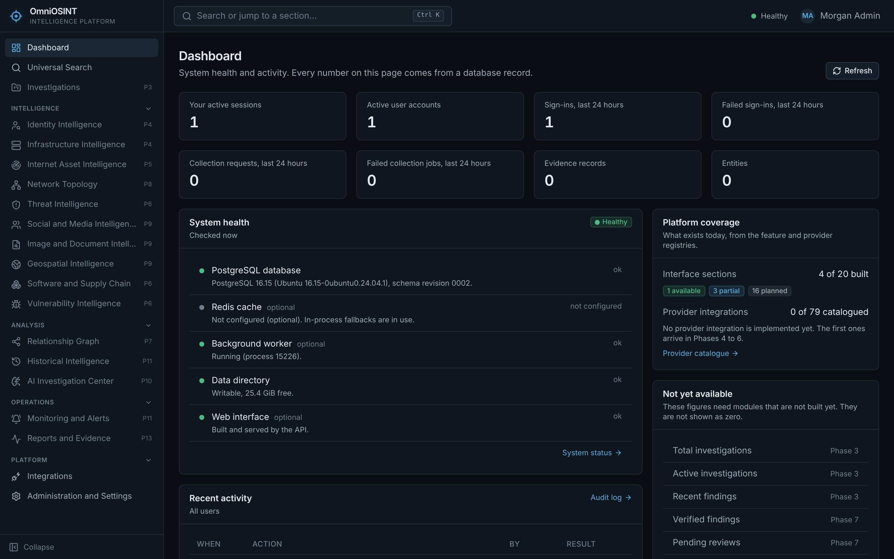
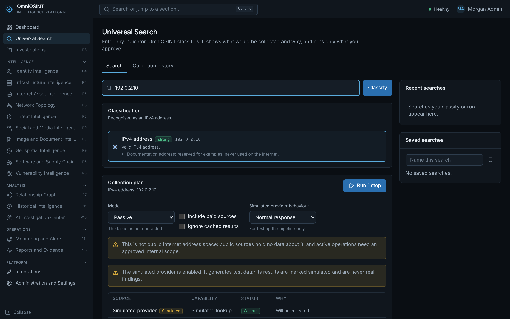

# OmniOSINT

An evidence-driven OSINT and intelligence investigation platform: collect from
lawful public and authorised sources, normalise everything into one entity and
relationship graph, keep the evidence behind every claim, and report it.

Windows 10/11 is the primary platform; Linux, including WSL2, is supported. It
runs on your own computer and listens on that computer only.

> **Project status: Phase 2 of 14 complete.** The platform foundation and the
> core intelligence pipeline work: universal search classifies any indicator,
> shows a collection plan and runs it through a job queue, a scope manager and
> an evidence store. **No real provider is integrated yet**, so nothing real is
> collected: the first integrations arrive in Phases 4 to 6. A simulated
> provider, off by default and labelled everywhere, exercises the pipeline with
> test data. Unbuilt sections show *Planned — not yet implemented* with the
> phase that delivers each. See [docs/ROADMAP.md](docs/ROADMAP.md) and
> [CHANGELOG.md](CHANGELOG.md).

## Quick start (Windows)

1. Install Python 3.12+, Node.js 22.22+ and PostgreSQL 15+ (the installer
   checks, and can install the first two with winget if you agree).
2. Double-click **`install.bat`**. It creates the Python environment, builds the
   interface and sets up the database; it asks before changing anything.
3. Double-click **`start.bat`**. Your browser opens the first-run setup page;
   create the administrator account.

`stop.bat` stops it. `health-check.bat`, `backup.bat`, `restore.bat`,
`update.bat`, `restart.bat` and `uninstall.bat` do what their names say.

On Linux: `scripts/linux/install.sh`, then `.venv/bin/omniosint start --open`.

Full instructions: [docs/INSTALLATION.md](docs/INSTALLATION.md).

## What works today

* **Universal search**: one box for 24 input types (email, phone, domain, URL,
  IP, range, AS number, hashes, certificate fingerprints, CVE, packages,
  repositories, coordinates and more). Input is validated and normalised on
  your computer; ambiguous input lists every reading for you to choose. Search
  history and saved searches.
* **Collection plans and jobs**: before anything runs, the plan lists every
  source that could serve the indicator and why it would or would not be used
  (planned, not configured, paid, cached, needs approval, blocked). Jobs run in
  the background with retries, cancellation, approval and a history that shows
  the real reason for every failure.
* **Evidence store**: every observation is kept with its source, job, raw
  response and transformations, append-only and hashed, with an integrity check.
  Raw responses are encrypted on disk and expire after 90 days by default.
* **Scopes**: active work runs only inside a recorded scope (written
  authorisation, targets, exclusions, validity), checked three times and
  approved by a person.
* **Accounts and access**: first-run setup with a one-time token, sign-in,
  password policy, lockout, sessions you can review and end, four built-in
  roles, user administration that cannot lock you out.
* **Audit trail** of every security-relevant action, append-only in the
  database.
* **Dashboard** of real records only: figures that need unbuilt modules are
  listed as not yet available, never shown as zero.
* **Provider framework and catalogue**: the adapter contract with rate limits,
  circuit breaker, caching and an outbound HTTP client that cannot be pointed at
  internal addresses; a catalogue of 79 data sources and tools with their access
  terms and planned phase.
* **Operations**: `omniosint` command line (including `classify`,
  `investigate`, `jobs`, `evidence` and `scopes`), health checks and `doctor`
  diagnostics, backup and atomic restore including raw responses, protected
  secret storage (DPAPI on Windows).
* **Interface**: twenty-section navigation, Ctrl+K command palette (type an
  indicator to search for it), dark and light themes.
* **Desktop shell** (Tauri) that starts, watches and stops the service.

## Principles

* **Evidence before conclusions.** Every finding will link to a stored,
  attributable observation. Observed facts, inferred relationships and AI
  summaries are kept apart.
* **Safe by default.** Passive collection unless you define a scope and approve
  an active operation. The interface is local-only.
* **Honest about coverage.** A source that is not configured, not implemented or
  failing is shown as exactly that. No sample data is presented as a result.

## Documentation

| Document | Contents |
|---|---|
| [INSTALLATION](docs/INSTALLATION.md) | Install, configure, update, back up, uninstall |
| [USER_GUIDE](docs/USER_GUIDE.md) | Using the interface and the command line |
| [ADMIN_GUIDE](docs/ADMIN_GUIDE.md) | Processes, health, accounts, audit, configuration |
| [DEVELOPER_GUIDE](docs/DEVELOPER_GUIDE.md) | Setup, tests, conventions |
| [ARCHITECTURE](docs/ARCHITECTURE.md) | Design and the decisions behind it |
| [ROADMAP](docs/ROADMAP.md) | The fifteen phases and their acceptance criteria |
| [FEATURE_INVENTORY](docs/FEATURE_INVENTORY.md) | Every feature, its phase and status |
| [DATABASE_SCHEMA](docs/DATABASE_SCHEMA.md) | Data model |
| [PROVIDERS](docs/PROVIDERS.md) | Provider framework and catalogue |
| [API_REFERENCE](docs/API_REFERENCE.md) | HTTP API (generated) |
| [UI_NAVIGATION](docs/UI_NAVIGATION.md) | Interface structure |
| [RISK_REGISTER](docs/RISK_REGISTER.md) | Known risks and mitigations |
| [DEPENDENCIES](docs/DEPENDENCIES.md) | Dependency inventory (generated) |
| [SECURITY](SECURITY.md) / [PRIVACY](PRIVACY.md) | Security design, data handling |
| [CHANGELOG](CHANGELOG.md) | Changes and phase reports |

## Responsible use

OmniOSINT is for lawful research and authorised security work. It does not
implement unauthorised account access, credential attacks, acquisition of
private subscriber records, tracking of people or phones, access-control bypass
or destructive testing, and it will not. You are responsible for having a
lawful basis and, for anything active, written authorisation.

## Licence

No licence has been chosen yet. Until the owner adds one, all rights are
reserved.
