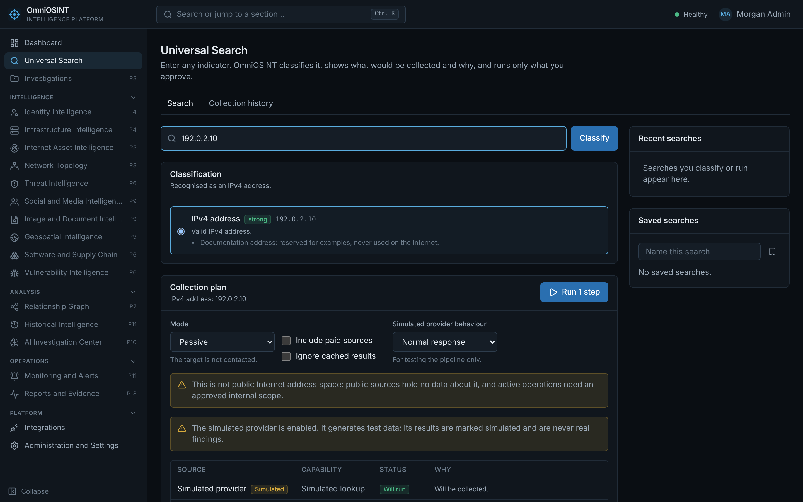
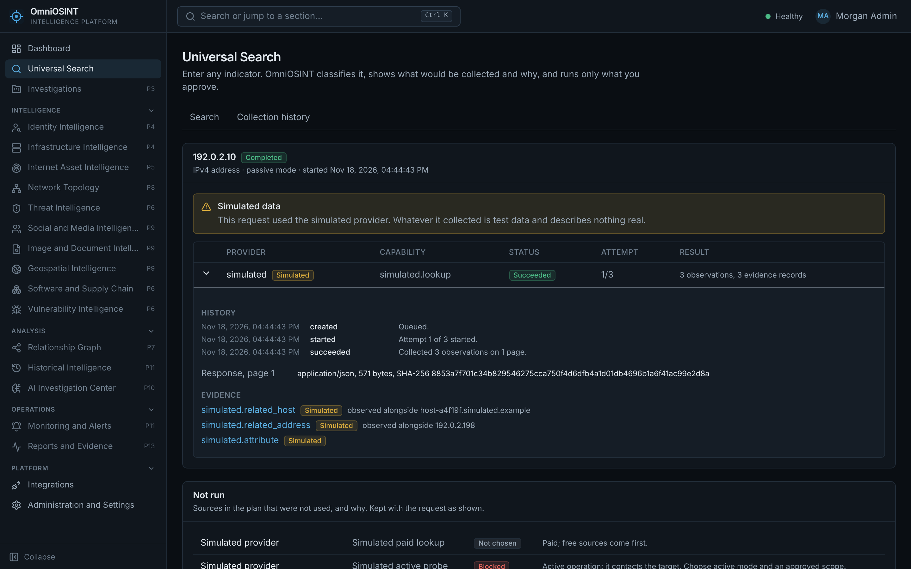

# User guide

This guide covers what OmniOSINT can do today (Phases 1 and 2). Intelligence
features are added phase by phase; until then their sections in the interface
say **Planned — not yet implemented** and name the phase that delivers them.

**No real data source is connected yet.** Universal search classifies input
and plans collection, but every real provider is still planned (Phases 4 to
6). Collection can only be tried with the [simulated
provider](#the-simulated-provider), whose results are test data.

## Signing in

Open the address printed by `start.bat` (normally <http://127.0.0.1:8765>).

* **First run.** The first start opens the setup page with a one-time token.
  Create the first administrator account there. If you lost the link, run
  `omniosint admin setup-token` on the same computer.
* **Sign-in.** Use your username and password. After five wrong passwords in a
  row the account is locked for 15 minutes; an administrator can unlock it
  earlier.
* **Temporary passwords.** If an administrator created your account or reset
  your password, you are asked to choose a new one before anything else.

Passwords need at least 12 characters, at least five different characters, and
must not contain your username. Several unrelated words make a good password.

Sessions end after 2 hours without activity, or 12 hours after sign-in.

## The interface

* **Sidebar.** The twenty sections of OmniOSINT, grouped into Intelligence,
  Analysis, Operations and Platform. Sections not built yet are dimmed and show
  their phase (for example `P5`). Groups can be collapsed; the sidebar becomes
  an icon rail on narrow windows.
* **Command palette.** Press **Ctrl+K** (Cmd+K on a Mac) to jump to any section
  or run an action (switch theme, sign out). Type an indicator and choose
  "Search for ..." to open it in Universal Search.
* **Status indicator.** The dot in the top bar shows the overall system status.
* **Account menu.** Your account, the theme (dark or light) and sign-out.

If the OmniOSINT service stops while the page is open, a red banner says so and
the page reconnects automatically once it is running again.

## Dashboard

* Counts from the database: your active sessions, and for administrators active
  accounts and sign-ins in the last 24 hours.
* **System health**: database, Redis, background worker, data folder and web
  interface.
* **Recent activity** from the audit log (everyone's for auditors and
  administrators, only your own otherwise).
* **Collection** (with `collection:read`): requests and failed jobs in the
  last 24 hours; and with `evidence:read`, evidence records and entities.
  These count real records only. Simulated evidence, if there is any, has its
  own figure, labelled as test data.
* **Platform coverage**: how many sections and provider integrations exist.
* **Not yet available**: figures such as investigations or alerts that need
  modules not built yet. They are listed with their phase and never shown as
  zero.

## Universal Search



Type or paste any indicator: an email address, phone number, username, domain,
URL, IPv4 or IPv6 address, address range or network prefix, AS number, file
hash, certificate fingerprint, CVE, package (`npm:left-pad`,
`pkg:pypi/requests`), repository or profile URL, coordinates, or an
organisation name. Defanged indicators (`hxxp://`, `example[.]com`) are read
correctly. Classification happens on your computer; nothing is sent anywhere.

* **Classification** shows the reading with its strength (strong, plausible,
  weak), the reason, and notes such as "documentation address" or "no country
  code". Credentials in a pasted URL are removed before anything is stored.
* **Ambiguous input** (a 40-character hex string can be a file hash or a
  certificate fingerprint) lists every reading. Nothing is planned until you
  choose one.
* **Phone numbers** need a country code (`+44 ...`) unless an administrator set
  a default region. A carrier or region from numbering data never identifies
  who holds a number.
* **Questions** and **files** are recognised, but are handled by later phases
  (the AI engine in Phase 10, uploads in Phase 9).

### The collection plan

For an indicator that can be collected, the plan lists every source that could
serve it and what would happen: **Will run**, **Cached result** (a fresh
earlier result is reused), **Needs approval**, **Blocked** (with the scope
manager's reason), **Not chosen** (paid, while free sources come first),
**Planned** or **Not configured**. Options:

| Option | Effect |
|---|---|
| Mode | **Passive** never contacts the target. **Active** may contact it and needs a scope and an approval |
| Scope | In active mode, the recorded scope that authorises the work |
| Include paid sources | Plan paid sources too; above the configured credit threshold they wait for approval |
| Ignore cached results | Call again even if a fresh result exists |

**Run** queues the plan and opens the request. You need the `collection:run`
permission; others can see plans but not run them. Running a plan also adds it
to your recent searches.

### Collection history and requests



**Collection history** lists every request, newest first. A request shows its
jobs (one per source and capability) with status, attempts and result. Open a
job for its history (queued, started, scope checked, retried, finished), the
raw responses it received, and the evidence it produced.

* A failure shows the provider's real reason (timeout, rate limit, quota,
  credentials refused, malformed response, outage). Temporary failures are
  retried automatically with increasing delays; the others are not.
* **Approve** (`collection:approve`) releases a job that waits for approval.
* **Cancel** stops a job; a running job stops at its next checkpoint.
* **Retry** queues a failed or cancelled job again.
* **Not run** lists the sources in the plan that were not used, and why, as
  they were when the plan ran.

### Evidence

Each evidence record is one observation about one entity, with its
**provenance** (source, collection and observation times, the provider's own
identifier, the job, the transformation steps) and an **integrity check** that
recomputes the hashes of the record and of the raw response. Evidence is never
edited; a correction would be a new record.

The **raw response** is shown with credential-like fields masked. Showing it
unmasked needs `evidence:read_raw` and is recorded in the audit trail. A
response that is not JSON cannot be masked, so it is only shown unmasked.
Raw responses are kept for 90 days by default; after that the evidence keeps
their hash.

"Mentions" on evidence are entities the source named alongside the indicator.
They are candidate relationships, not confirmed links.

### Scopes

Anything active runs only inside a **scope**: a record that written
authorisation exists, who gave it, until when, and which targets it covers and
excludes. Analysts can see scopes and choose one in active mode; administrators
record and revoke them (**Administration > Scopes**). A scope can be checked
against a target before use. Active jobs always wait for approval, and the
scope is checked again when the job is approved and just before it runs.

### The simulated provider

When an administrator turns it on, a **Simulated provider** appears in plans.
It contacts nothing and generates test data in documentation ranges
(`192.0.2.x`, `*.simulated.example`). Everything it produces is labelled
**Simulated** (plans, requests, jobs, evidence, entities) and is counted apart
on the dashboard. Its **Simulated provider behaviour** option makes it fail on
purpose (timeout, outage, rate limit, quota, refused credentials, malformed or
partial response) so you can see how failures are handled.

### Recent and saved searches

Searches you classify or run appear under **Recent searches** (the newest 200
are kept; you can clear them). **Saved searches** keep a query under a name.

## Integrations

The catalogue of data sources and tools OmniOSINT is designed to use (Shodan,
Censys, VirusTotal, NVD and many more), with each one's access model, the phase
that integrates it, and notes about tiers and limits. Filter by category,
status or text.

**Adapters** lists the provider adapters that exist (today only the simulated
provider) with their capabilities, and runs a health check on request. No real
provider can be configured or queried yet; credentials and quotas arrive with
the first integrations.

## Administration and Settings

What you see depends on your role.

| Page | Who | What |
|---|---|---|
| My account | Everyone | Profile, permissions, password change, theme, active sessions (end any of them) |
| Users | `users:read`; changes need `users:manage` | Create, edit, deactivate, delete, reset passwords, clear lockouts |
| Roles | `roles:read` | The built-in roles and their permissions |
| Scopes | `scopes:read`; changes need `scopes:manage` | Record, check and revoke scopes for active work |
| Audit log | `audit:read` | Every security-relevant action; filter and open an entry for its details |
| System status | `system:read` | Component checks, version, runtime and data folder |

Built-in roles:

| Role | Purpose |
|---|---|
| administrator | Everything, including user management, recording scopes, approving active jobs and unmasked raw responses |
| analyst | Search, run collection, read evidence (masked raw responses) and scopes |
| auditor | Read-only: users, roles, audit log, system status, collection history, evidence and scopes |
| viewer | Read-only access to what they are assigned (cases, from Phase 3); nothing yet |

OmniOSINT never lets the last active administrator be deactivated, demoted or
deleted. A deleted account cannot sign in again and its username cannot be
reused, so the audit log stays unambiguous.

## Command line

Everything the scripts do is available as `omniosint` (inside `.venv`):

```text
omniosint classify INPUT | --file PATH
omniosint search INPUT [--type T] [--mode active --scope ID]
omniosint investigate INPUT [--type T] [--mode passive|active] [--scope ID]
                      [--provider P ...] [--include-paid] [--force-refresh]
                      [--dry-run] [--wait | --no-wait] [--json]
omniosint jobs list | show | approve | cancel | retry
omniosint evidence list | show [--raw]
omniosint scopes list | create | revoke
omniosint start | stop | restart | status
omniosint doctor
omniosint db check | upgrade | current | bootstrap
omniosint admin create-user | list-users | reset-password | setup-token
omniosint secrets set | list | delete
omniosint config show | paths | validate | set | unset
omniosint backup create [--no-raw-responses] | list | verify | restore
omniosint providers list | test
omniosint openapi
```

* `classify` works offline. `--file` classifies a file from its first bytes.
* `search` shows the plan without collecting anything. `investigate` runs it:
  the worker does the work (start OmniOSINT first), and `--wait` (the default)
  shows the results when the jobs finish.
* `scopes create` needs `--confirm-authorization`, your statement that written
  authorisation exists for every target listed.
* `providers test` runs the health check of each adapter that can be tested:
  status 0 when all pass, 1 when one fails, 2 when there was nothing to test.

Commands run as the local operator (recorded in the audit trail as `cli`).
Commands for features that are not built (`cases`, `graph`, `report`,
`reports`, `monitoring`) say so and exit with status 2.
